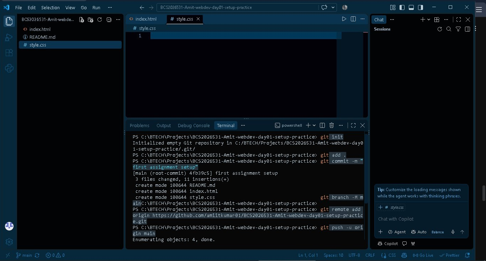
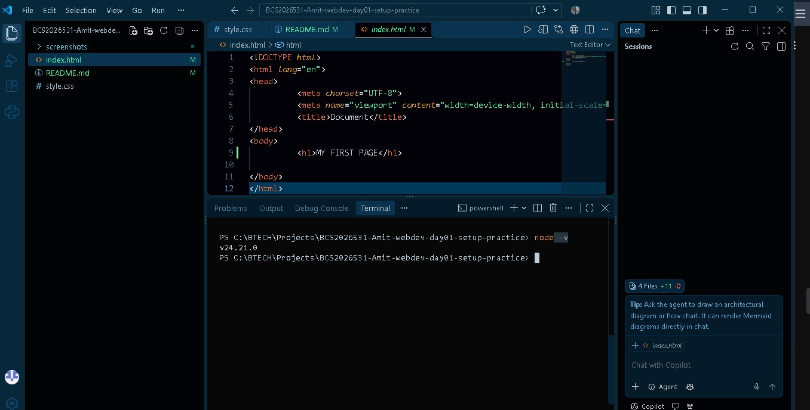
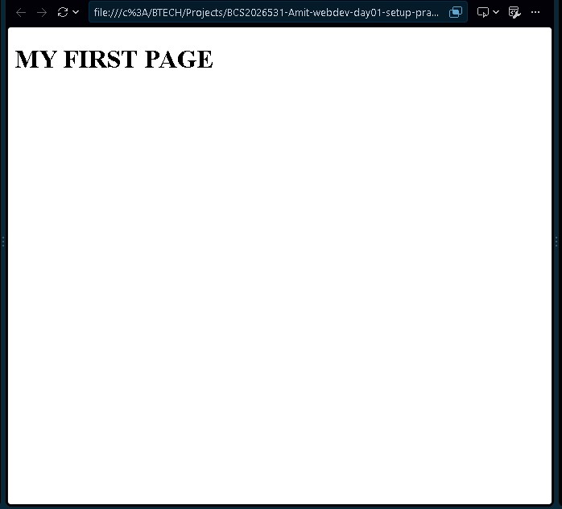
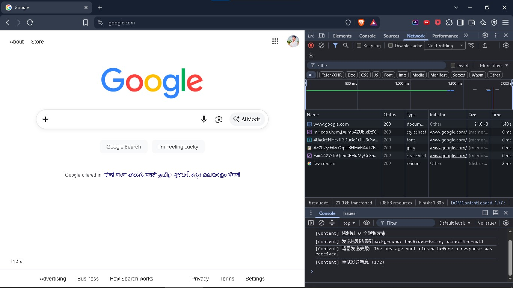

## Setup screenshots

### VS Code with the project open

### Node.js version

### Page running with Live Server

## Chrome DevTools network inspection

- Website: `https://www.google.com`
- Date inspected: `22-Oct-2026`
- Steps: Opened Chrome DevTools, selected Network, and reloaded the page.
- Request types observed: `document, stylesheet, script, image, font`
- Example status codes: `200`
- Observation: `The main HTML document loaded successfully with status code 200, followed by stylesheets and images.`
- Evidence: 

## Terminal Commands Learned

- **`mkdir`** : creates a directory (folder). You can give it several folder names at once[cite: 5].
- **`cd`** : changes the current directory[cite: 5].
- **`type nul > filename`** : creates an empty file[cite: 5].
- **`dir`** : lists the current folder's contents[cite: 5].
- **`tree /f`** : shows the folder tree, including files[cite: 5].

## Terminal Navigation Practice

1. Current path: `C:\BTECH\Projects\BCS2026531-Amit-webdev-day01-setup-practice`
2. `dir` showed: `css`, `js`, `images`, `screenshots`, `README.md`, `index.html`
3. Created `terminal-practice` with: `mkdir terminal-practice`
4. Entered it with: `cd terminal-practice`
5. Moved to its parent with: `cd ..`
6. `tree /f` showed: A complete folder tree structure of my project including all files.